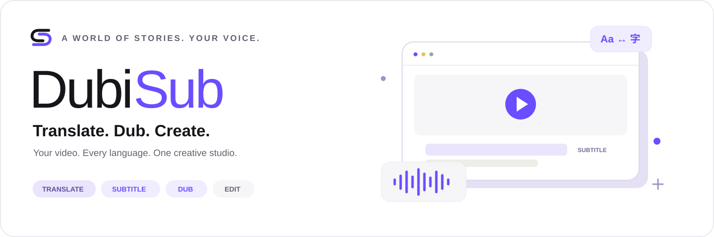

<div align="center">



# DubiSub

**A local-first studio for multilingual video translation, subtitles, AI dubbing, and editing.**

🇻🇳 Vietnamese by default · 🌍 Built for many languages · 🎬 Your creative workflow

[](https://github.com/ericismee/dubisub/stargazers)
[](https://github.com/ericismee/dubisub/forks)
[](LICENSE)


[Why DubiSub](#-why-dubisub) · [Roadmap](#-roadmap) · [Development](#-development) · [Tiếng Việt](README.vi.md)

</div>

> **M1 local foundation is runnable and verified.** Create/reopen projects, upload/probe media, import/extract/edit subtitles, autosave, undo/redo, preview and export SRT/VTT. Translation, ASR, voices, review rendering and video editing remain planned. No installer or release is provided; GitHub badges query the repository and do not describe application usage.

## ✨ Why DubiSub

One workspace to take a video from its original language to a new audience: import, transcribe, translate, refine, voice, edit, and export.

The planned experience combines precise subtitle work with a general video timeline. Vietnamese is the default translation target; language availability depends on the configured ASR, translation, and voice providers. Film reviews and full-length dubbing are selectable workflows.

## 🧭 Planned workflow

**📥 Import → 📝 Transcribe → 🌍 Translate → 🎙️ Voice → ✂️ Edit → 📤 Export**

- 📥 **Files or links:** inspect video/audio/subtitle tracks, choose quality, download supported sources or import subtitles only.
- 🌍 **Multilingual subtitles:** side-by-side editing, glossary, speaker names, multiple target languages, timing validation, and versioned translations.
- 🎙️ **Voice selection:** VieNeu for Vietnamese, provider-supported voices for other languages, language/gender filters, and cached audio samples.
- ✂️ **Video editing:** multiple tracks, trim/split/ripple, proxy preview, waveform, text, overlays, transitions, keyframes, and audio mixing.
- 🎬 **Two creative modes:** film review with a new script/timeline, or translation/narration/dubbing aligned to the original video.
- 📤 **Flexible outputs:** SRT/VTT/ASS, narration audio, subtitled video, and dubbed video. Export subtitles without waiting for a video render.
- 💾 **Resilient work:** autosave, undo/redo, durable background jobs, cancellation, retry, and segment checkpoints.

This is the product roadmap. M1 implements the local subtitle foundation; see [STATUS](docs/STATUS.md) for verified behavior and limitations.

## 🗺️ Roadmap

- [x] Product brief and acceptance criteria
- [x] Shared Codex / Claude / Cursor project guidance
- [x] Project-scoped development skills and hash audit
- [x] **M1 — Local foundation baseline:** project library, upload/probe, subtitle editor, real subtitle export
- [ ] **M2 — Link import (baseline verified):** YouTube/direct files, format/subtitle selection and bounded jobs; authentication, playlists, manifests and broader QA remain pending
- [ ] **M3 — Translation:** ASR fallback, glossary, multiple target languages, automation presets
- [ ] **M4 — Editing core:** multitrack timeline, trim/split/ripple, preview and render
- [ ] **M5 — Voice & review:** voice samples, speaker mapping, dubbing alignment, review export
- [ ] **M6 — Editing polish:** titles, overlays, transitions, keyframes, color/audio controls
- [ ] **M7 — Advanced tools:** OCR, diarization, stems, stabilization, and tracking as validated

## 🏗️ Architecture

- **UI:** React + TypeScript + Vite
- **API:** async FastAPI / Python
- **Storage:** SQLite migrations and local media files
- **Jobs:** a separate durable worker with checkpoints
- **Media:** FFmpeg / FFprobe; yt-dlp adapter for supported links
- **AI:** configurable ASR, translation, and TTS adapters

Local-first means local project/media storage. Selecting a remote AI provider sends the required content to that provider; fully offline operation depends on installing compatible local models.

## 🛠️ Development

Prerequisites: Windows, uv, Node/npm, FFmpeg and FFprobe on PATH. Dependencies are local to this project; Python 3.12.13 is selected by `.python-version`.

```powershell
cd D:/WorkSpace/dubisub
uv sync --locked
npm ci --prefix frontend
powershell -ExecutionPolicy Bypass -File scripts/start.ps1
```

Open **http://127.0.0.1:3600**. The API runs at `127.0.0.1:6060` (`/health`, `/docs`). The launcher refuses occupied ports and does not stop existing services. Keep its terminal open; stop with Ctrl+C, or run `powershell -ExecutionPolicy Bypass -File scripts/stop.ps1` from another terminal. This is a local development build, independent of NotebookE.

Create a project, import a video and SRT/VTT/ASS, edit text/timing, wait for “Đã tự lưu”, reopen from the library, then export SRT/VTT. Click a cue number to seek. Embedded text subtitles are extracted by the separate durable worker. ASS styling is flattened; browser playback depends on container/codec support (MP4 H.264 verified on Windows Edge). Image subtitles are not transcribed.

Generate synthetic sample media with `.venv/Scripts/python scripts/make_sample.py`; output is in `data/samples`. These are test patterns and authored subtitles, not AI output.

Configuration uses process environment variables listed in `.env.example`; this file is a reference and is **not automatically loaded**. Data defaults to `./data`. Provider settings persist endpoint/model and a `DUBISUB_*` key-variable name only; M1 never calls a provider or claims capabilities. No key is required for M1.

Validation:

```powershell
.venv/Scripts/python -m pytest -q
npm --prefix frontend run build
.venv/Scripts/python scripts/check_e2e.py
npm audit --prefix frontend
```

E2E requires installed Microsoft Edge, ports 3600/6060 free and FFmpeg. It creates separate temporary data and owned server processes, then stops them. Screenshots are saved under ignored `test-results/`. See [SETUP_AUDIT](docs/SETUP_AUDIT.md) and [STATUS](docs/STATUS.md) for evidence, operational limits and the next milestone.

## 🤝 Contributing

Start with the brief and roadmap. Include a concrete use case, expected behavior, and validation evidence with proposed changes. Keep original media immutable and credentials out of Git. Use media you are authorized to process; protected/unsupported sources must fail clearly.

## 📊 Repository activity

GitHub-backed metrics below reflect the published repository, not application usage or benchmark performance.

[](https://github.com/ericismee/dubisub/issues)
[](https://github.com/ericismee/dubisub/pulls)
[](https://github.com/ericismee/dubisub/commits)
[](https://github.com/ericismee/dubisub)

## 🙌 Acknowledgements & licensing

Planned integrations include FFmpeg, yt-dlp, faster-whisper, and VieNeu. Project development skills come from Anthropic, Vercel, Superpowers, and Sentry; see [SKILLS.md](SKILLS.md) and [THIRD_PARTY_NOTICES.md](THIRD_PARTY_NOTICES.md).

DubiSub original project code, documentation, and original SVG brand assets are licensed under the [MIT License](LICENSE). Copyright (c) 2026 ericismee. Third-party models, voices, fonts, media tools, and included skills retain their own terms; see [THIRD_PARTY_NOTICES.md](THIRD_PARTY_NOTICES.md).

---

<div align="center">If this direction would help your workflow, a ⭐ helps others discover DubiSub.</div>


### Latest local features

Default dark studio, persistent light/dark and cursor choices, grouped settings (Appearance/ASR/Translation/TTS/Storage), project metadata edit and recoverable deletion are available. Delete cancels work and hides the project; it preserves original files. Use Restore to undo.

Paste a YouTube or direct media/subtitle URL in the media library, analyze it, select content and import. DubiSub downloads into its own local store; no manual download/upload is needed. A public short YouTube sample completed inspect/download/merge/probe. Some videos require unsupported verification; playlists/live/DRM/authenticated sources, generic web pages, manifest streams and JS challenges remain unsupported. Direct-file servers must accept HEAD. See STATUS for exact test coverage and limitations. AI settings still store configuration only.
